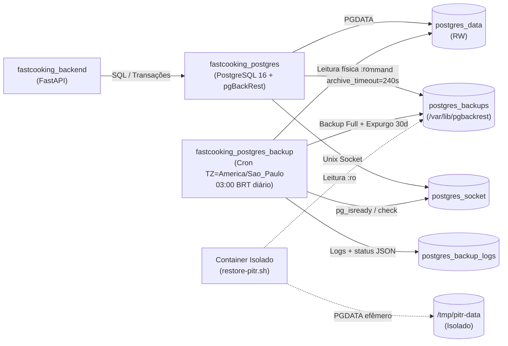

# 🛡️ Runbook de Backup Diário, Retenção (30 dias) e PITR (RPO <= 5 min) — FastCooking

Este documento descreve a arquitetura, operação, monitoramento de falhas e procedimento de restauração pontual (Point-In-Time Recovery — PITR) do PostgreSQL 16 integrado ao ambiente Docker do **FastCooking**.

---

## 1. Arquitetura da Solução



### Garantias Mecânicas
- **SGBD:** PostgreSQL 16 (`postgres:16-bookworm`) com extensões `uuid-ossp` e `pgcrypto`.
- **Mecanismo:** `pgBackRest` com arquivamento contínuo de WAL nativo do PostgreSQL (`wal_level = replica`, `archive_mode = on`, `archive_command = 'pgbackrest --stanza=fastcooking archive-push %p'`).
- **RPO <= 5 minutos:** Garantido mecanicamente por `archive_timeout = 240s` (4 minutos — 60s de margem de segurança abaixo do teto de 300s). Em horário de pico, segmentos WAL de 16 MB cheios são arquivados imediatamente em segundos; em períodos ociosos, o PostgreSQL força rotação e arquivamento no máximo a cada 240s.
- **Backup Completo na Madrugada (BRT):** Executado 1x ao dia às `03:00` no fuso `America/Sao_Paulo` (configurado via `/etc/localtime`, `/etc/timezone`, `TZ=America/Sao_Paulo` e `CRON_TZ=America/Sao_Paulo`), evitando degradação durante o horário comercial.
- **Retenção Mínima de 30 Dias sem Corromper Cadeias:** `repo1-retention-full-type=time` e `repo1-retention-full=30`. O `pgBackRest` só expurga backups completos com mais de 30 dias e remove apenas os WALs estritamente anteriores ao LSN inicial do backup completo mais antigo ainda retido.
- **Destino dos Backups:** Volume Docker dedicado `postgres_backups` (`/var/lib/pgbackrest`), desacoplado do volume de dados `postgres_data`. Em produção, recomenda-se habilitar também o `repo2` (S3/MinIO) em `infra/postgres/config/pgbackrest.conf` para cópia off-site.

---

## 2. Variáveis de Ambiente e Segredos

Defina no arquivo `.env` na raiz do repositório (baseado em `.env.example`):

| Variável | Padrão | Descrição |
| :--- | :--- | :--- |
| `TZ` | `America/Sao_Paulo` | Fuso horário oficial do PostgreSQL e do agendador cron. |
| `POSTGRES_USER` | *(obrigatório)* | Usuário administrador do PostgreSQL. |
| `POSTGRES_PASSWORD` | *(obrigatório)* | Senha do PostgreSQL (suporta `POSTGRES_PASSWORD_FILE` para Docker Secrets). |
| `POSTGRES_DB` | *(obrigatório)* | Nome do banco de dados (`fastcooking_db`). |
| `POSTGRES_PORT` | `5432` | Porta exposta do PostgreSQL no host. |
| `BACKUP_STANZA` | `fastcooking` | Nome da stanza do `pgBackRest`. |
| `BACKUP_CRON_SCHEDULE` | `0 3 * * *` | Expressão cron no fuso `America/Sao_Paulo` (03:00 BRT). |
| `BACKUP_RETENTION_DAYS` | `30` | Retenção mínima em dias (bloqueado abaixo de 30). |
| `BACKUP_RUN_INITIAL` | `false` | Se `true`, executa backup completo inicial na primeira subida caso não haja backups. |
| `BACKUP_MAX_AGE_HOURS` | `26` | Limite de idade do último backup para alerta no healthcheck. |

> **Segurança:** Nunca faça hardcode de senhas em `docker-compose.yaml`, `pgbackrest.conf` ou scripts. Em produção, utilize Docker Secrets (`POSTGRES_PASSWORD_FILE=/run/secrets/postgres_password`).

---

## 3. Operação Diária

### Subir o ambiente
```bash
cp .env.example .env
# Edite .env com credenciais seguras
docker compose up -d --build
```

### Consultar histórico de backups e janela de recuperação (PITR)
```bash
docker exec -u postgres fastcooking_postgres_backup pgbackrest --stanza=fastcooking info
```

### Disparar backup completo manual (ex.: antes de migração crítica)
```bash
docker exec -u postgres fastcooking_postgres_backup /usr/local/bin/fastcooking-backup/backup-full.sh
```

### Verificar fuso horário e agendamento cron ativos
```bash
docker exec fastcooking_postgres_backup date
docker exec fastcooking_postgres_backup cat /etc/cron.d/fastcooking-backup
```

---

## 4. Monitoramento de Falhas e Alertas

1. **Docker Healthcheck Automático:** O container `fastcooking_postgres_backup` executa `/usr/local/bin/fastcooking-backup/healthcheck-backup.sh` a cada 5 minutos, validando:
   - `pgbackrest --stanza=fastcooking check` (arquivamento WAL funcional);
   - `archive_timeout <= 300s` ativo no PostgreSQL;
   - `pg_stat_archiver` sem falhas ativas (`last_failed_time > last_archived_time`);
   - Idade do último backup completo `<= BACKUP_MAX_AGE_HOURS` (26h).
2. **Arquivo Estruturado de Status (JSON):** Após cada execução de backup, o status é gravado em `/var/log/pgbackrest/last-backup-status.json` (`status: "SUCCESS" | "FAILED"`, timestamps, duração e tamanho):
   ```bash
   docker exec fastcooking_postgres_backup cat /var/log/pgbackrest/last-backup-status.json
   ```
3. **Inspeção de Logs de Execução:**
   ```bash
   docker exec fastcooking_postgres_backup tail -n 50 /var/log/pgbackrest/fastcooking-backup.log
   docker exec fastcooking_postgres_backup tail -n 50 /var/log/pgbackrest/cron.log
   ```
4. **Monitoramento SQL do Archiver:**
   ```bash
   docker exec fastcooking_postgres psql -U "$POSTGRES_USER" -d "$POSTGRES_DB" -c \
     "SELECT archived_count, last_archived_wal, last_archived_time, failed_count, last_failed_wal, last_failed_time FROM pg_stat_archiver;"
   ```

---

## 5. Runbook de Restauração Pontual (PITR) em Ambiente Isolado

> **Regra de Ouro:** Nunca restaure diretamente sobre o volume `postgres_data` em produção. Sempre restaure em um container isolado, valide os dados recuperados via SQL e só então promova ou extraia os dados.

### Passo 1: Identificar a janela disponível no repositório
```bash
docker exec -u postgres fastcooking_postgres_backup pgbackrest --stanza=fastcooking info
```

### Passo 2: Subir container isolado montando os backups em modo somente leitura (`:ro`)
```bash
BACKUP_VOL=$(docker inspect -f '{{range .Mounts}}{{if eq .Destination "/var/lib/pgbackrest"}}{{.Name}}{{end}}{{end}}' fastcooking_postgres_backup)

docker run -d \
  --name fastcooking_pitr_restore \
  -u postgres \
  -e TZ=America/Sao_Paulo \
  -e POSTGRES_USER="$POSTGRES_USER" \
  -e POSTGRES_DB="$POSTGRES_DB" \
  -v "${BACKUP_VOL}:/var/lib/pgbackrest:ro" \
  fastcooking-postgres:16-pgbackrest \
  bash -c "/usr/local/bin/fastcooking-backup/restore-pitr.sh --target-time '2026-11-25 14:30:00-03' --data-dir /tmp/pitr-data --port 5433 && sleep 3600"
```

### Passo 3: Validar dados restaurados na instância isolada
```bash
docker exec fastcooking_pitr_restore psql -h /tmp -p 5433 -U "$POSTGRES_USER" -d "$POSTGRES_DB" -c \
  'SELECT count(*) AS total_pedidos FROM "Pedido"; SELECT count(*) AS total_pagamentos FROM "Pagamento";'
```

### Passo 4: Encerrar container isolado após extração/validação
```bash
docker rm -f fastcooking_pitr_restore
```

---

## 6. Validação Automatizada de RPO (<= 5 minutos)

Execute o script reproduzível a partir da raiz do projeto (em Linux/macOS/WSL/Git Bash):
```bash
bash infra/postgres/scripts/test-rpo-validation.sh
```
O script realiza backup completo inicial, insere transações críticas (`Restaurante` → `Mesa` → `Pedido` → `Pagamento`) após o backup, insere um registro pós-alvo, valida o arquivamento WAL dentro da janela de 5 minutos sem novo backup completo, restaura via PITR em container isolado e comprova via SQL que os dados críticos foram recuperados com integridade referencial e perda zero (<= 5 min).
